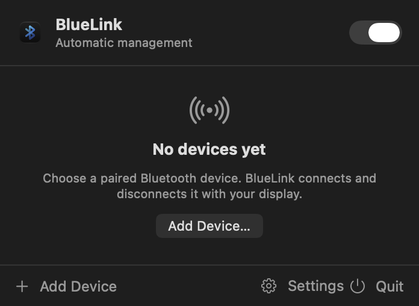
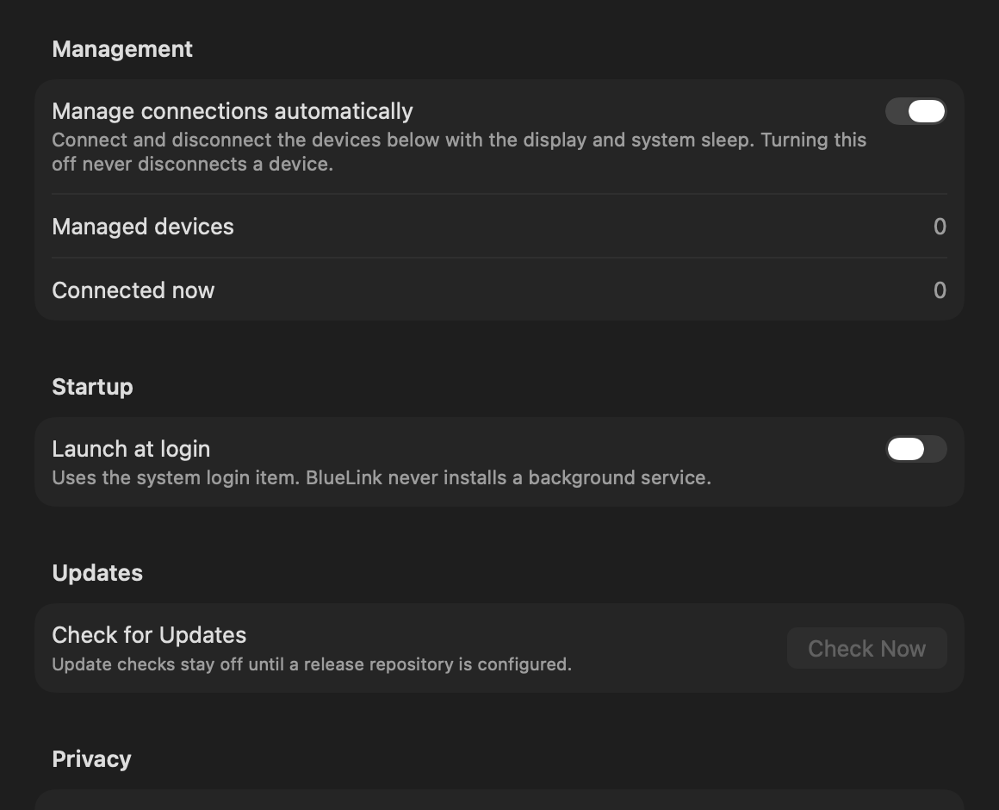
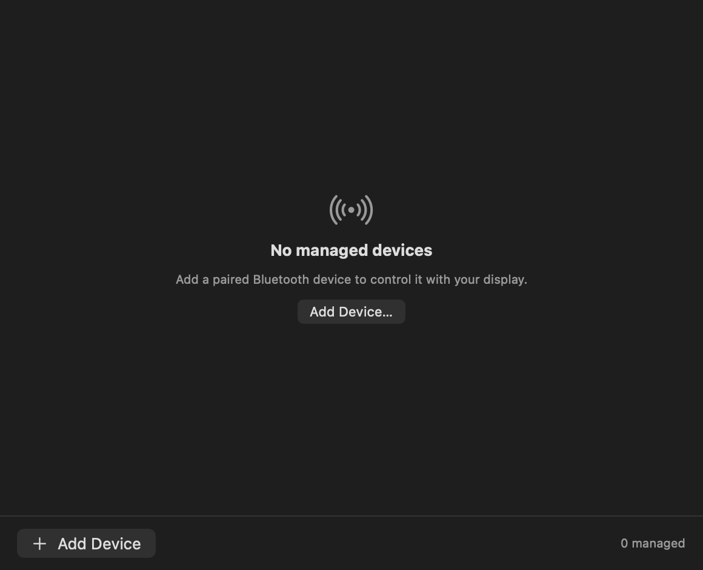
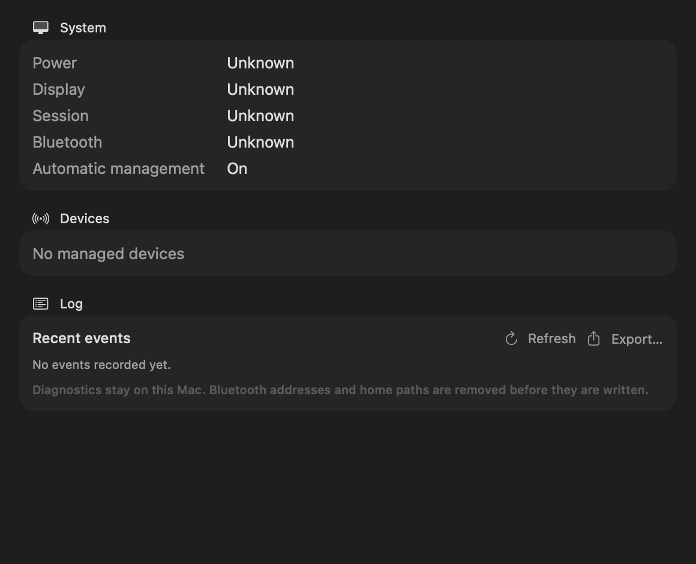

# BlueLink

<p align="center">
  
</p>

<p align="center">A native macOS menu-bar app that connects your chosen Bluetooth devices when the display wakes and disconnects them when the display sleeps.</p>

<p align="center">
  <a href="README.zh-CN.md">简体中文</a> ·
  <a href="docs/README.md">Documentation</a> ·
  <a href="CONTRIBUTING.md">Contributing</a> ·
  <a href="#build-and-run">Build</a>
</p>

<p align="center">
  
  
  
  <a href="https://github.com/mentalfl0w/BlueLink/actions/workflows/ci.yml"></a>
</p>

BlueLink is deliberately small. It manages only the devices you select, reacts to display and system sleep events, and uses documented Apple frameworks. There is no account, cloud service, background helper, telemetry, or idle polling.

The app is useful when a classic Bluetooth device does not reconnect cleanly after the Mac wakes. BlueLink makes the intended state explicit, performs one operation at a time per device, and reports what the system actually observes.

## See BlueLink

<table>
  <tr>
    <td width="50%" align="center"><br><sub>Menu bar panel — automation at a glance, with manual controls</sub></td>
    <td width="50%" align="center"><br><sub>General — global automation, launch at login, updates</sub></td>
  </tr>
  <tr>
    <td width="50%" align="center"><br><sub>Devices — per-device policy, audio output, removal</sub></td>
    <td width="50%" align="center"><br><sub>Diagnostics — observed state and a sanitized local log</sub></td>
  </tr>
</table>

Screenshots are offscreen renders of the real SwiftUI views. The test target produces them without mock data or a debug entry point. See [Verification](docs/VERIFICATION.md) for the test that generates them.

## What it does

- **Display-aware automation.** Connect a managed device when the display wakes; disconnect it when the display sleeps or the Mac sleeps.
- **Bounded recovery.** If a managed device drops unexpectedly, BlueLink retries with exponential backoff and a per-period flapping limit. It never runs a permanent retry loop.
- **Manual control.** Connect, disconnect, retry, or pause a device from the menu bar. Pause persists across launches; a manual disconnect suppresses automation until the next real wake cycle.
- **Optional audio routing.** Choose a preferred output device. BlueLink applies it once after a successful connection and never fights later manual changes.
- **Local-first diagnostics.** Recent events stay on the Mac. Exported logs redact Bluetooth addresses and user paths.
- **Signed updates.** Sparkle checks the signed GitHub appcast; automatic checks and background downloads are opt-in, and installation is confirmed before quitting.
- **English and Simplified Chinese.** The full interface ships in both languages.

## How it decides

BlueLink separates the observed system state, the device's desired state, and the operation in flight. An unknown state never triggers an automatic operation.

| Situation | Automatic target |
|---|---|
| No managed device, paused, or global automation off | `unmanaged`; keep the current connection |
| Session inactive, Bluetooth off, or state unknown | `unmanaged`; do not fight the system |
| Display asleep | Disconnect when `disconnectOnDisplaySleep` is on; otherwise `unmanaged` |
| Display awake on a real wake cycle | Connect when `connectOnDisplayWake` is on |
| Unexpected drop while awake | Reconnect when `reconnectOnUnexpectedDisconnect` is on, within budget |
| Manual disconnect in this wake cycle | `unmanaged` until the next wake cycle |

The table is an overview. [Connection policy](docs/CONNECTION_POLICY.md) is the canonical contract for events, priorities, late callbacks, and retry limits.

## Safety boundaries

- Never pairs, unpairs, or changes the system Bluetooth power state.
- Never manages a device you did not select.
- Input devices are hidden by default and require explicit confirmation.
- Never requests sudo, Accessibility, Screen Recording, or Full Disk Access.
- Never installs a privileged helper or a background service.
- No scanning, no idle timer, no silent audio playback.
- No account, cloud sync, telemetry, advertising, or paid tier.

## Requirements

- macOS 26 or later. Developed and tested on macOS 27.3.
- Xcode 27.2 and Swift 6.4.2 to build.
- [XcodeGen](https://github.com/yonaskolb/XcodeGen) 2.46; build-time only.

## Build and run

The project uses one XcodeGen spec: `Apps/MacApp/project.yml`. Do not edit `BlueLink.xcodeproj` by hand.

```sh
./scripts/generate-project.sh   # regenerate BlueLink.xcodeproj
./scripts/build.sh              # Debug build
open build/DerivedData/Build/Products/Debug/BlueLink.app

./scripts/test.sh               # package tests + app tests + boundary and docs checks
./scripts/package-dmg.sh        # dist/BlueLink-<version>-<build>.dmg and .zip
```

The app is a menu-bar app (`LSUIElement`); it has no Dock icon. On first use, grant Bluetooth access when macOS asks. Select **Add Device** in the menu bar panel, choose a paired classic Bluetooth device, and configure its policy in Settings.

### Optional hardware test

The real-device test is opt-in and never embeds an address. It records the connection state on entry and restores it on exit.

```sh
BLUELINK_REAL_DEVICE=1 \
BLUELINK_TEST_DEVICE_ID=AA-BB-CC-DD-EE-FF \
BLUELINK_TEST_DEVICE_NAME="Test Device" \
swift test --package-path Platform/MacIntegration --filter RealDeviceTests
```

Run it only for a device you are authorized to connect and disconnect.

## Verification

| Layer | Result |
|---|---|
| Core (`Packages/BlueLinkCore`) | 44 tests pass |
| Platform (`Platform/MacIntegration`) | 24 tests run: 23 pass, 1 hardware test skipped by default |
| App (`Apps/MacApp`) | 21 tests pass (presentation, localization, Sparkle configuration, window and snapshot tests) |
| Real hardware M01 | Passed: manual connect, disconnect, and reconnect of a paired test device, 5.976 s |
| Distribution | Ad-hoc local DMG/ZIP, SHA256; not Developer ID signed or notarized |

Display sleep/wake, system sleep, dark wake, long-idle recovery, login-item restart, and audio output on real hardware are **Not tested**. See [Verification](docs/VERIFICATION.md) for the matrix and evidence.

## Documentation

- [Documentation index](docs/README.md) — all guides and their responsibilities.
- [Connection policy](docs/CONNECTION_POLICY.md) — the canonical state and event contract.
- [Platform integration](docs/PLATFORM_INTEGRATION.md) — public APIs, permissions, and platform limits.
- [Product design](docs/PRODUCT_DESIGN.md) — menu bar, Settings, localization, and icon rules.
- [Implementation](docs/IMPLEMENTATION.md) — repository layout, phases, and delivery status.
- [Verification](docs/VERIFICATION.md) — automated results, hardware matrix, and open checks.
- [Decisions](docs/DECISIONS.md) and [changelog](docs/CHANGELOG.md) — decisions and recorded evidence.

## Limitations

- macOS controls menu-bar overflow. On a crowded menu bar, the BlueLink item can be hidden.
- Updates use a signed GitHub appcast and Sparkle. Automatic checks and downloads are off by default; when enabled, Sparkle may download in the background and asks before installing when BlueLink quits. The app is still ad-hoc signed, not notarized.
- The published 1.0.0 and 1.0.1 releases predate Sparkle. Install the first Sparkle-enabled release (1.0.2 or later) manually; later releases can update through Sparkle.
- Ad-hoc signatures are not distribution signatures. Gatekeeper still prompts, and Bluetooth authorization may reset when the signature changes.
- The app manages classic Bluetooth devices. BLE/GATT-only devices are not guaranteed to support the classic connection APIs.

## License

MIT. See [LICENSE](LICENSE). Copyright © 2026 Dylan Liu.
