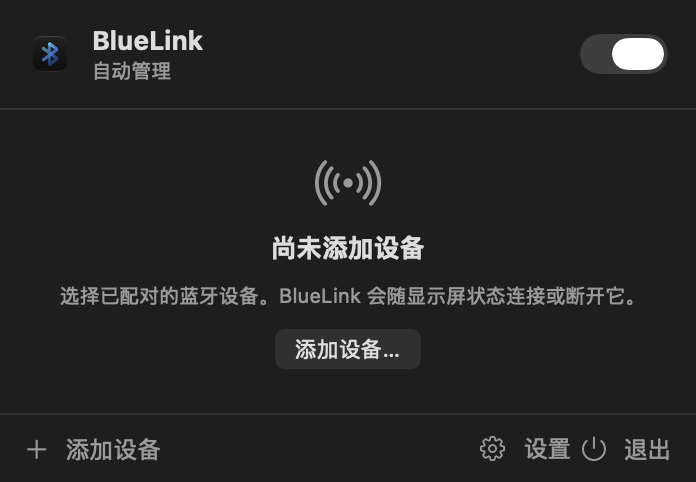
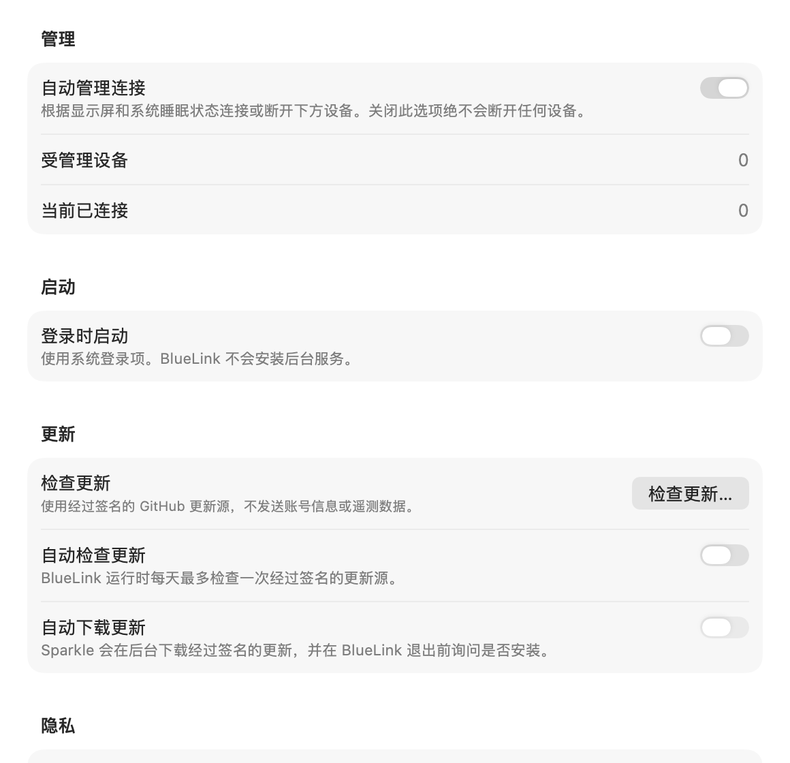
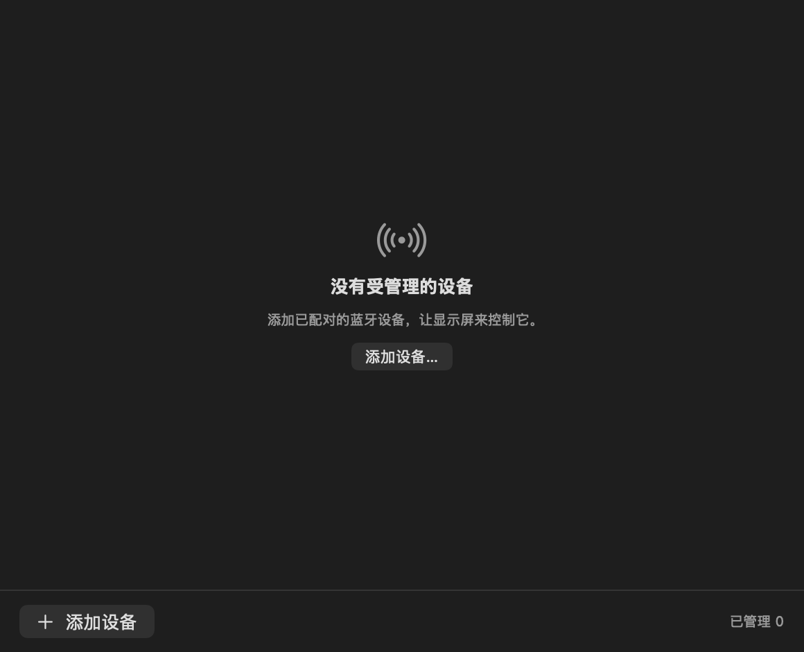
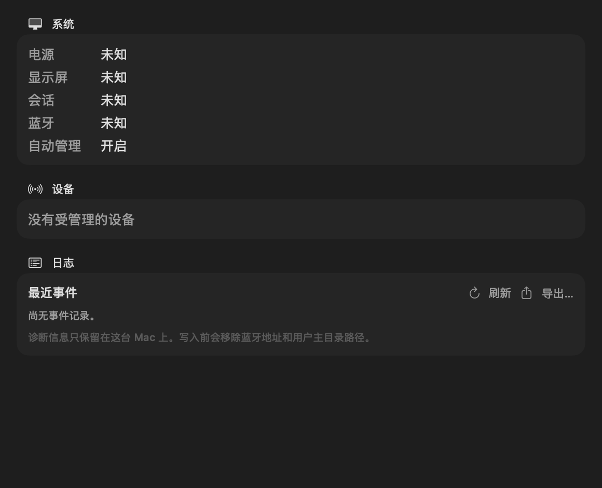

# BlueLink

<p align="center">
  
</p>

<p align="center">一款原生 macOS 菜单栏应用：显示屏唤醒时连接你选择的蓝牙设备，息屏时断开。</p>

<p align="center">
  <a href="README.md">English</a> ·
  <a href="docs/README.zh-CN.md">文档索引</a> ·
  <a href="CONTRIBUTING.zh-CN.md">参与贡献</a> ·
  <a href="#构建与运行">构建</a>
</p>

<p align="center">
  
  
  
  <a href="https://github.com/mentalfl0w/BlueLink/actions/workflows/ci.yml"></a>
</p>

BlueLink 刻意保持小巧。它只管理你明确选择的设备，只响应显示屏与系统睡眠事件，并且只使用 Apple 文档化的框架。没有账号、云服务、后台助手、遥测或空闲轮询。

当经典蓝牙设备在 Mac 唤醒后没有可靠重连时，BlueLink 能把目标状态说清楚：每台设备同一时间只执行一个操作，并如实报告系统实际观察到的状态。

## 界面

<table>
  <tr>
    <td width="50%" align="center"><br><sub>菜单栏面板 — 自动管理状态与手动控制</sub></td>
    <td width="50%" align="center"><br><sub>通用 — 全局自动管理、登录时启动、更新</sub></td>
  </tr>
  <tr>
    <td width="50%" align="center"><br><sub>设备 — 独立策略、首选音频输出、移除托管</sub></td>
    <td width="50%" align="center"><br><sub>诊断 — 实际状态与脱敏本地日志</sub></td>
  </tr>
</table>

截图为真实 SwiftUI 视图的离屏渲染，由测试目标生成，不注入假数据，也没有调试入口。生成方式见[验收矩阵](docs/VERIFICATION.zh-CN.md)。

## 功能

- **跟随显示屏。** 显示屏唤醒时连接托管设备；息屏或系统睡眠时断开。
- **有界恢复。** 托管设备意外掉线后按指数退避重试，并限制单位时间内的反复掉线次数；不会永久重试。
- **手动控制。** 在菜单栏面板中连接、断开、重试或暂停设备。暂停跨重启保留；手动断开后，当前亮屏周期内不再自动连接。
- **可选音频输出。** 选择首选输出设备后，BlueLink 在连接成功时切换一次，不覆盖用户之后的系统选择。
- **本地优先诊断。** 最近事件只保存在本机；导出前移除蓝牙地址和用户路径。
- **签名更新。** Sparkle 检查经签名的 GitHub appcast；自动检查和后台下载默认关闭，安装前会确认并可在退出时进行。
- **中英文完整界面。** 菜单栏、设置与关于页均提供英文和简体中文。

## 决策方式

BlueLink 将系统实际状态、设备目标状态和正在执行的操作分开建模。状态未知时绝不触发自动操作。

| 场景 | 自动目标 |
|---|---|
| 未托管、已暂停或全局自动管理关闭 | `unmanaged`；保持当前连接 |
| 会话非活跃、蓝牙关闭或状态未知 | `unmanaged`；不与系统争抢 |
| 显示屏息屏 | 开启“息屏时断开”则断开，否则 `unmanaged` |
| 真实亮屏周期且显示屏唤醒 | 开启“亮屏时连接”则连接 |
| 亮屏期间意外掉线 | 开启“意外断连时重连”则在预算内重连 |
| 当前亮屏周期内手动断开 | 保持 `unmanaged`，直到下一个真实亮屏周期 |

上表只是概览。[连接策略](docs/CONNECTION_POLICY.zh-CN.md)是事件、优先级、迟到回调与重试上限的唯一语义来源。

## 安全边界

- 绝不配对、取消配对或改变系统蓝牙开关。
- 绝不管理你未选择的设备。
- 输入设备默认隐藏，托管前必须明确确认。
- 不请求 sudo、辅助功能、屏幕录制或完全磁盘访问权限。
- 不安装特权助手或后台服务。
- 不扫描、无空闲定时器、无静默音频播放。
- 无账号、云同步、遥测、广告或付费墙。

## 环境要求

- macOS 26 或更高；当前在 macOS 27.3 上开发与测试。
- 构建需要 Xcode 27.2 与 Swift 6.4.2。
- [XcodeGen](https://github.com/yonaskolb/XcodeGen) 2.46，仅构建期使用。

## 构建与运行

工程只有一个 XcodeGen 规格：`Apps/MacApp/project.yml`。不要手改 `BlueLink.xcodeproj`。

```sh
./scripts/generate-project.sh   # 重新生成 BlueLink.xcodeproj
./scripts/build.sh              # Debug 构建
open build/DerivedData/Build/Products/Debug/BlueLink.app

./scripts/test.sh               # 包测试 + App 测试 + 边界与文档检查
./scripts/package-dmg.sh        # dist/BlueLink-<version>-<build>.dmg 与 .zip
```

App 是菜单栏应用（`LSUIElement`），没有 Dock 图标。首次读取已配对设备时，按系统提示授予蓝牙权限。在菜单栏面板点“添加设备”，选择已配对的经典蓝牙设备，再到设置中配置策略。

### 可选实机测试

实机测试必须显式开启，且不会硬编码蓝牙地址。测试进入时记录连接状态，结束时恢复。

```sh
BLUELINK_REAL_DEVICE=1 \
BLUELINK_TEST_DEVICE_ID=AA-BB-CC-DD-EE-FF \
BLUELINK_TEST_DEVICE_NAME="Test Device" \
swift test --package-path Platform/MacIntegration --filter RealDeviceTests
```

仅对你获授权连接和断开的设备运行。

## 验证结果

| 层级 | 结果 |
|---|---|
| Core（`Packages/BlueLinkCore`） | 44 项测试通过 |
| Platform（`Platform/MacIntegration`） | 24 项执行：23 项通过，1 项硬件测试默认跳过 |
| App（`Apps/MacApp`） | 19 项通过（状态呈现、本地化、窗口与快照） |
| 实机 M01 | 通过：已配对测试设备的手动连接、断开与再次连接，5.976 s |
| 分发 | ad-hoc 本地 DMG/ZIP + SHA256；未 Developer ID 签名、未公证 |

息屏/亮屏、系统睡眠、dark wake、长时间闲置恢复、登录项重启与实机音频输出仍为 **Not tested**。矩阵与证据见[验收矩阵](docs/VERIFICATION.zh-CN.md)。

## 文档

- [文档索引](docs/README.zh-CN.md) — 全部指南及职责。
- [连接策略](docs/CONNECTION_POLICY.zh-CN.md) — 状态与事件契约的唯一来源。
- [平台集成](docs/PLATFORM_INTEGRATION.zh-CN.md) — 公共 API、权限与平台限制。
- [产品设计](docs/PRODUCT_DESIGN.zh-CN.md) — 菜单栏、设置、本地化与图标规则。
- [实现计划](docs/IMPLEMENTATION.zh-CN.md) — 目录、阶段与交付状态。
- [验收矩阵](docs/VERIFICATION.zh-CN.md) — 自动化结果、实机矩阵与待验证项。
- [决策记录](docs/DECISIONS.zh-CN.md) 与 [变更日志](docs/CHANGELOG.zh-CN.md) — 决策与实际证据。

## 已知限制

- macOS 管控菜单栏溢出；菜单栏过满时 BlueLink 图标可能被隐藏。
- 更新使用经签名的 GitHub appcast 与 Sparkle。自动检查和下载默认关闭；开启后 Sparkle 可在后台下载，并在 BlueLink 退出前询问是否安装。App 仍为 ad-hoc 签名，未公证。
- 已发布的 1.0.0 与 1.0.1 早于 Sparkle 集成；首个支持 Sparkle 的版本（1.0.2 或更高）需要手动安装，之后才可通过 Sparkle 自动更新。
- ad-hoc 签名不是分发签名。Gatekeeper 仍会提示，签名变化可能导致蓝牙授权重置。
- 仅管理经典蓝牙设备；仅支持 BLE/GATT 的设备不保证支持经典连接接口。

## 许可证

MIT，见 [LICENSE](LICENSE)。版权所有 © 2026 Dylan Liu。
